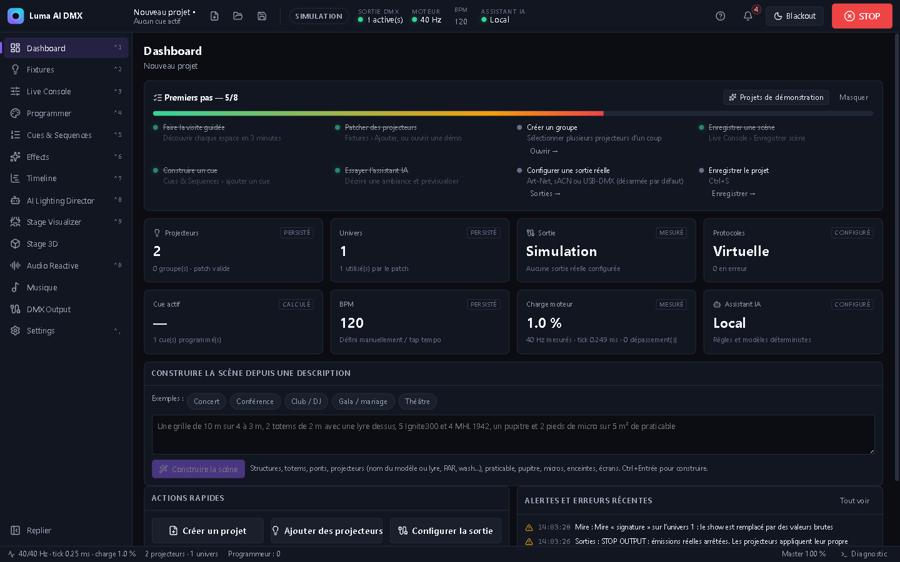
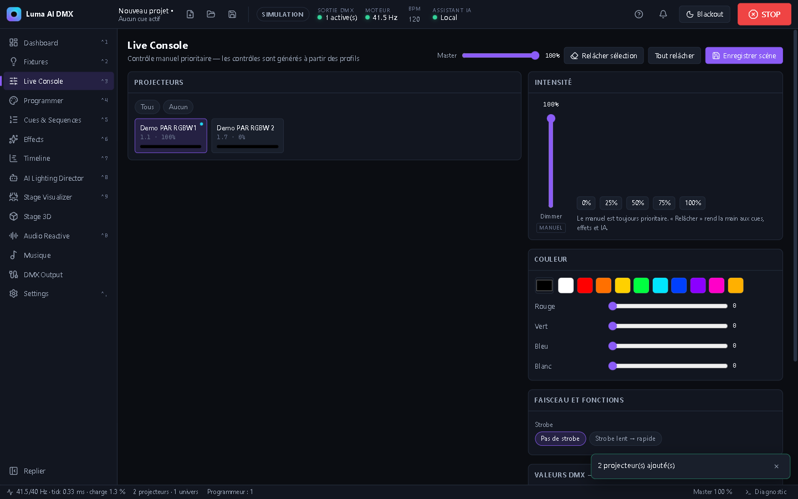
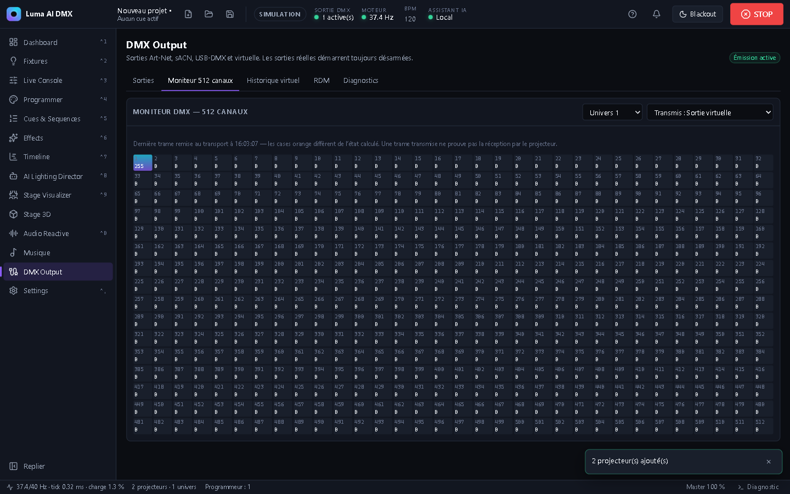
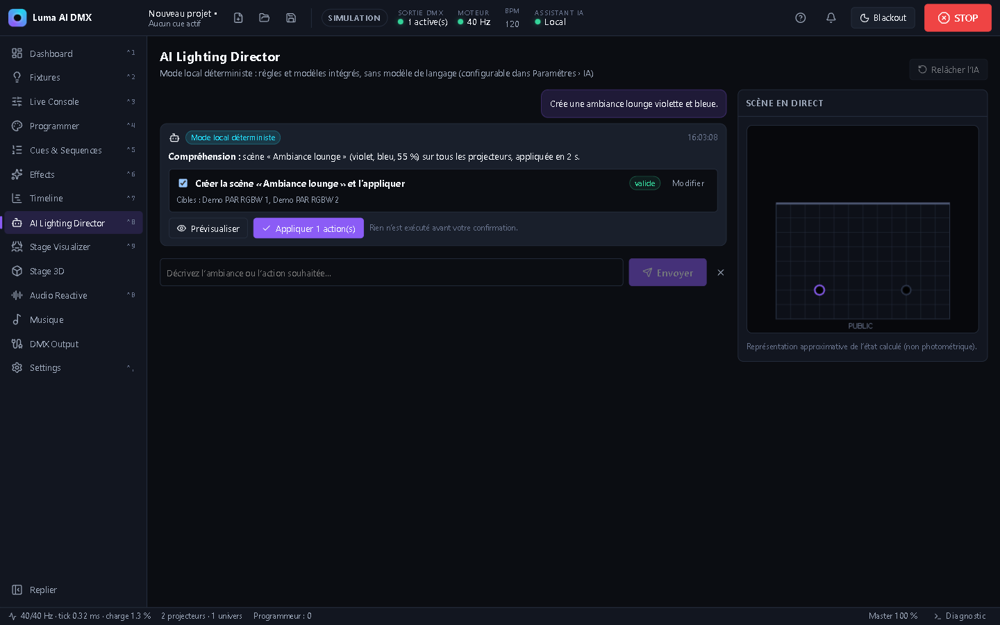
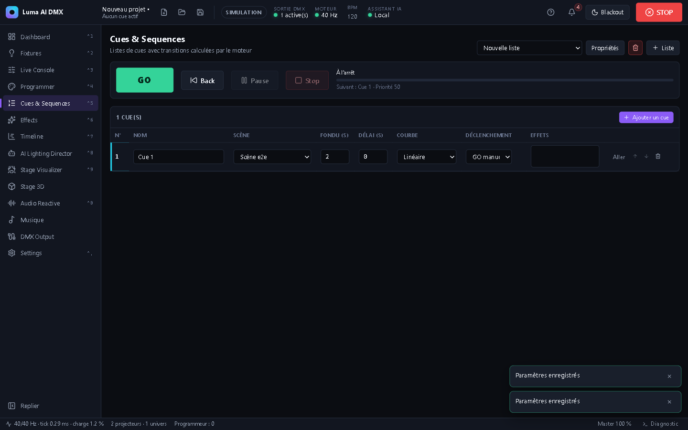
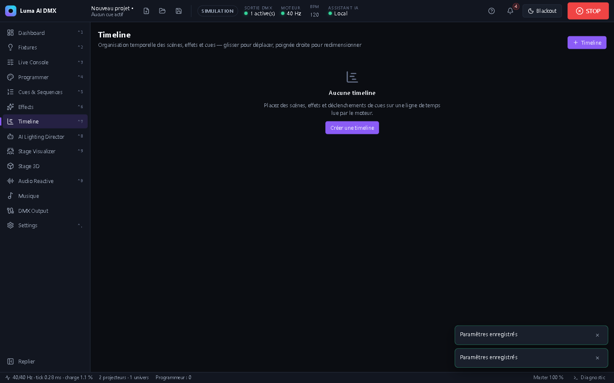
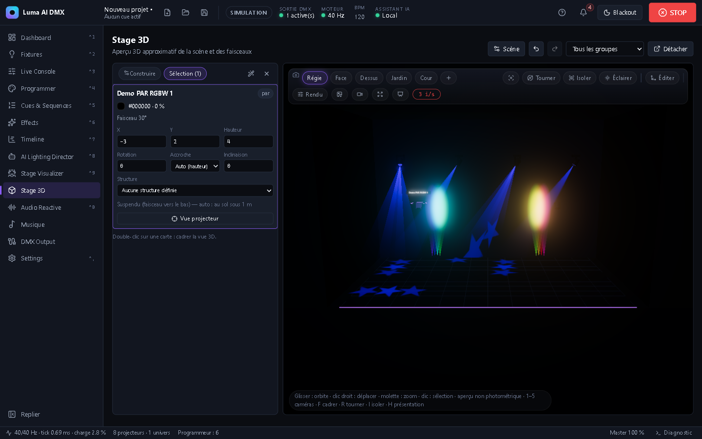
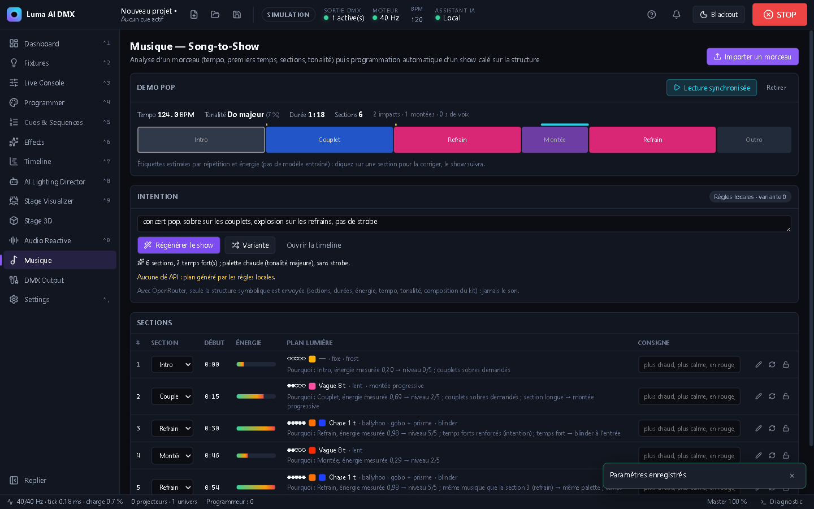

# Luma AI DMX

<p align="center">
  <strong>LIGHTING CONTROL · SHOW PROGRAMMING · AI-ASSISTED PRODUCTION</strong><br>
  <em>Concevoir, programmer, visualiser et piloter des spectacles lumière depuis un environnement desktop unifié.</em>
</p>

<p align="center">
  <a href="https://github.com/moonback/Luma-AI-DMX"></a>
  
  
  
  
  
</p>

<p align="center">
  <strong>Une console lumière assistée par IA, avec un moteur DMX indépendant de l'interface.</strong>
</p>

> [!IMPORTANT]
> **État de référence :** le dépôt déclare la version 1.9.0. Le README d'origine annonce 615 tests automatisés. Ce chiffre n'est pas une exécution effectuée pendant cette mise à jour documentaire. Aucun projecteur ni interface DMX physique n'est déclaré comme validé. Les limites et niveaux de validation sont explicités dans ce document.

---

## Sommaire

- [Vision produit](#vision-produit)
- [Fonctionnalités](#fonctionnalités)
- [Aperçu de l'application](#aperçu-de-lapplication)
- [Architecture](#architecture)
- [Moteur lumière et sorties DMX](#moteur-lumière-et-sorties-dmx)
- [Bibliothèque de projecteurs](#bibliothèque-de-projecteurs)
- [IA et assistance vocale](#ia-et-assistance-vocale)
- [Sécurité opérationnelle](#sécurité-opérationnelle)
- [Installation](#installation)
- [Commandes de développement](#commandes-de-développement)
- [Données, confidentialité et mode hors ligne](#données-confidentialité-et-mode-hors-ligne)
- [Licences applicatives](#licences-applicatives)
- [Limites et validation matérielle](#limites-et-validation-matérielle)
- [Structure du dépôt](#structure-du-dépôt)
- [Documentation complémentaire](#documentation-complémentaire)
- [Contribution](#contribution)
- [Licence du code source](#licence-du-code-source)

## Vision produit

Luma AI DMX est une application desktop de contrôle d'éclairage développée avec Electron, React et TypeScript. Elle associe programmation lumière traditionnelle, visualisation de scène, analyse musicale et assistance par intelligence artificielle.

Le produit est organisé autour d'une séparation essentielle : **le moteur lumière ne dépend pas de l'interface React**. La logique de programmation, le calcul des valeurs DMX, les règles de priorité et les validations peuvent ainsi être testés sans ouvrir la fenêtre Electron.

L'identité de marque est centralisée dans [src/shared/brand.ts](src/shared/brand.ts).

## Fonctionnalités

| Domaine | Capacités disponibles |
|---|---|
| Console | Live Console, Console Simplifiée, contrôles générés depuis les profils, palettes et actions rapides |
| Programmation | Programmeur, scènes, cues, séquences, effets, timeline, undo/redo |
| Sorties | Art-Net, sACN / E1.31, USB-DMX selon les adaptateurs implémentés, sortie virtuelle |
| Visualisation | Vue 2D, Stage Visualizer 3D Three.js, faisceaux, gobos, brume, structures et décor |
| Fixtures | Import GDTF, OFL, grandMA2 XML, collections ZIP et MA Fixture Share |
| IA | Directeur IA, propositions structurées, validation, aperçu et rapport d'exécution |
| Audio | Analyse musicale, BPM, beats, sections, audio réactif et Song-to-Show |
| Voix | Assistant Gemini Live avec outils contrôlés |
| Contrôle externe | MIDI, OSC, MTC/LTC et télécommande réseau locale selon configuration |
| Exploitation | Projets, démonstrations, export PDF, licences hors ligne et diagnostics |

### Parcours métier

1. Créer ou ouvrir un projet.
2. Importer les profils et construire le patch.
3. Configurer les univers et les sorties.
4. Programmer les groupes, palettes, scènes, cues et effets.
5. Prévisualiser le spectacle dans le visualiseur 2D/3D.
6. Utiliser Song-to-Show ou le Directeur IA pour préparer des propositions.
7. Vérifier les avertissements et les actions proposées.
8. Armer explicitement la sortie physique et exploiter le spectacle.
9. Utiliser STOP OUTPUT pour interrompre immédiatement les émissions.

## Aperçu de l'application

Les captures sont issues des scénarios de test de bout en bout et sont disponibles dans [docs/screenshots](docs/screenshots/).

| Espace | Aperçu |
|---|---|
| Accueil et Dashboard |  |
| Live Console |  |
| Moniteur DMX |  |
| Directeur IA |  |
| Cues et séquences |  |
| Timeline |  |
| Stage Visualizer |  |
| Song-to-Show |  |

## Architecture

### Vue en couches

```text
┌─────────────────────────────────────────────────────────────┐
│                      RENDERER (React)                        │
│  Dashboard · Console · Timeline · Stage 3D · Settings · AI  │
└──────────────────────────────┬──────────────────────────────┘
                               │ API preload limitée
┌──────────────────────────────▼──────────────────────────────┐
│                    PRELOAD / SHARED                          │
│       invoke · on · commandes typées · contrats partagés     │
└──────────────────────────────┬──────────────────────────────┘
                               │ IPC validé
┌──────────────────────────────▼──────────────────────────────┐
│                    MAIN (Electron)                           │
│  fenêtres · cycle de vie · permissions · secrets · IPC      │
└──────────────────────────────┬──────────────────────────────┘
                               │ services / adaptateurs
┌──────────────────────────────▼──────────────────────────────┐
│                     CORE (Headless)                          │
│ moteur · patch · cues · effets · IA · audio · licences      │
│ règles métier · validation · sorties · sécurité             │
└──────────────────────────────┬──────────────────────────────┘
                               │
┌──────────────────────────────▼──────────────────────────────┐
│              OUTPUTS / EXTERNAL SYSTEMS                      │
│       Art-Net · sACN · USB-DMX · MIDI · OSC · Audio           │
└─────────────────────────────────────────────────────────────┘
```

| Couche | Responsabilité | Règle de conception |
|---|---|---|
| core | Moteur métier headless, programmation, calcul DMX, IA, audio, licences et politiques | Ne doit pas dépendre de React ou d'Electron |
| main | Processus principal Electron, fenêtres, IPC, secrets et cycle de vie | Autorité de validation et d'accès aux ressources système |
| preload | Pont minimal entre renderer et main | Exposer une API explicite, pas les primitives Node/Electron |
| renderer | Interface React, visualisation, interactions et localisation | Ne pas devenir une autorité métier ou matérielle |
| shared | Contrats, commandes, types et identité partagés | Source commune des contrats inter-couches |
| tests | Tests unitaires, intégration, composants, performance, IA et E2E | Vérifier les comportements et les limites documentées |

### Noyau headless

Le répertoire src/core constitue la base métier du produit. Il regroupe les responsabilités qui doivent rester testables indépendamment de l'interface : état du moteur, patch, règles de priorité, programmation, effets, sorties, traitement IA, audio et vérification des licences.

Cette séparation permet notamment :
- d'exécuter des tests sans démarrer Electron ;
- de simuler les sorties et les défaillances de transport ;
- de réutiliser les mêmes règles métier depuis plusieurs interfaces ;
- de maintenir une frontière claire entre proposition IA et action d'exploitation.

### IPC et validation Zod

Les commandes entre renderer et processus principal passent par le pont preload. Le renderer dispose d'une API limitée à deux primitives documentées : invoke et on.

Les entrées IPC sont validées par des schémas Zod dans le processus principal. Les origines non autorisées sont refusées. Les commandes doivent être considérées comme des contrats versionnés : nom stable, payload validé, réponse explicite et erreur structurée.

**Principe de sécurité :** une donnée TypeScript correctement typée dans le renderer n'est pas considérée comme fiable. La validation doit être répétée à la frontière de confiance, côté main.

### Cycle de vie d'une commande sensible

1. Le renderer formule une intention via une commande IPC autorisée.
2. Le processus principal contrôle l'origine et valide le payload.
3. Les règles métier et les permissions sont vérifiées.
4. Le service métier exécute ou refuse l'opération.
5. Le résultat est retourné sous une forme structurée et exploitable par l'interface.

## Moteur lumière et sorties DMX

### Protocoles et transports

| Transport | Usage | État et précautions |
|---|---|---|
| Art-Net | Transport DMX sur UDP/IP, univers mappés vers Port-Address | Format et émission UDP testés en boucle locale ; matériel réel non validé |
| sACN / E1.31 | Transport DMX sur réseau avec priorité et CID | Multicast/unicast ; terminaison de flux envoyée à l'arrêt |
| Enttec DMX USB Pro | Interface USB série compatible | Implémentation présente ; validation sur interface physique non déclarée |
| Open DMX / FTDI | Génération logicielle du signal DMX via USB série | Timing dépendant du système et du pilote ; validation matérielle nécessaire |
| Sortie virtuelle | Simulation et tests | Aucun signal matériel émis |

Le moteur travaille avec des univers DMX de 512 canaux. Le moniteur distingue l'état calculé par le moteur de la dernière trame transmise par chaque sortie. Une trame transmise ne prouve pas qu'un appareil l'a reçue.

### Priorités et programmation

- Le contrôle manuel est prioritaire.
- La fusion HTP est utilisée pour l'intensité.
- La fusion LTP est utilisée pour les autres paramètres.
- Une source de priorité supérieure remplace une source de priorité inférieure.
- Les scènes, cues, séquences et effets alimentent le moteur de sortie.
- Le programmeur peut être relâché explicitement.

### Sorties physiques désarmées par défaut

Les sorties réelles démarrent désarmées. L'opérateur doit les armer explicitement et confirmer l'action. Le statut SIMULATION / LIVE doit rester visible. STOP OUTPUT (Maj+Échap) interrompt les émissions réelles.

L'arrêt de transmission ne garantit pas l'extinction des appareils : chaque projecteur applique son propre comportement en cas de perte du signal DMX.

## Bibliothèque de projecteurs

Luma prend en charge plusieurs sources de profils :

| Source | Formats / usage |
|---|---|
| GDTF | Import de fichiers .gdtf et de leurs modes |
| MA Fixture Share | Ouverture dans une fenêtre isolée ; import de fiches compatibles grandMA2 XML, ZIP et GDTF |
| Bibliothèque grandMA2 locale | Import des profils disponibles dans l'installation grandMA2 onPC |
| Open Fixture Library (OFL) | Catalogue en ligne ou fichier OFL |
| Profil Luma | Format natif documenté par le projet |

Les profils décrivent les fonctions, canaux, plages et capacités des appareils. Les canaux spéciaux marqués dangereux, tels que reset ou extinction de lampe, sont protégés par une confirmation manuelle.

Les profils de démonstration « Luma Demo » sont fictifs et ne décrivent pas des références commerciales. Toujours vérifier un profil importé avec le manuel constructeur avant une exploitation réelle.

## IA et assistance vocale

### AI Lighting Director

Le Directeur IA transforme une intention en proposition d'actions typées. L'opérateur peut examiner les cibles, les avertissements et l'aperçu, modifier ou exclure des actions, puis appliquer la proposition.

Le contrat d'actions v3 comprend notamment :
- setIntensity, setColor, setPosition et setBeam ;
- startEffect, stopEffect et adjustEffect ;
- createScene, applyScene, createCue et createSequence ;
- setBpm et releaseAi.

L'IA ne transmet pas directement de trames DMX, n'exécute pas de code arbitraire et ne peut pas armer une sortie réelle. Les actions proposées sont revalidées avant application.

### Fournisseurs

| Mode | Fonctionnement | Réseau |
|---|---|---|
| Moteur local déterministe | Règles locales, sans modèle de langage distant | Non requis |
| OpenRouter | Génération de propositions par modèle externe, réponse revalidée par schéma strict | Requis |
| Gemini Live | Assistant vocal temps réel et outils contrôlés | Requis |

OpenRouter peut utiliser une sortie structurée JSON Schema, un mode JSON ou une consigne de format selon les capacités du modèle. En cas d'indisponibilité du fournisseur, un repli local est prévu et signalé.

La clé OpenRouter est stockée côté processus principal avec Electron safeStorage et n'est pas renvoyée au renderer ni enregistrée dans un projet.

### Gemini Live

L'assistant vocal utilise le SDK Google GenAI. Le processus principal fournit un jeton à usage unique au renderer ; la clé secrète n'est pas exposée directement à l'interface.

Les outils vocaux comprennent la proposition et l'application d'un éclairage, l'annulation, la consultation de l'état et le contrôle limité des cues. L'assistant ne peut pas armer une sortie réelle ni la réactiver après STOP.

**Confidentialité :** pendant une session vocale, le flux du microphone et les messages sont transmis à Google. Cette transmission ne concerne pas le mode local déterministe.

> [!NOTE]
> La documentation fonctionnelle actuelle confirme Gemini Live via le SDK Google GenAI. Le détail du transport réseau négocié par la version du SDK doit être vérifié dans le code et la documentation fournisseur avant de promettre une implémentation WebRTC spécifique.

### Song-to-Show et audio

L'analyse musicale locale extrait notamment tempo, beats, sections, tonalité, impacts et passages vocaux estimés. Song-to-Show transforme l'intention artistique en timeline composée de scènes, effets, mouvements et accents.

Comportement de la timeline générée :
- **Tempo du morceau.** La timeline porte le BPM analysé : ses effets synchronisés restent sur les temps quel que soit le BPM du projet ou du suivi audio. Une timeline créée à la main, sans BPM propre, suit le BPM du moteur.
- **Mouvements autour de la visée.** Les lyres oscillent autour de la position calculée pour chaque section, grâce au mode de mélange « Relatif » (`offset`), aussi disponible dans l'éditeur d'effets. Les formes pendule et zigzag ont leur propre trajectoire.
- **Flashs au temps.** « Snap » donne un flash par temps. Le strobe et le scintillement restent soumis à l'autorisation du strobe (Paramètres › IA) et au garde-fou photosensible. Sans autorisation, le planificateur ne les propose pas.
- **Voix.** Une section chantée n'a jamais de mouvement erratique (ballyhoo, aléatoire).
- **Retouches protégées.** Si la timeline, les scènes, les effets ou la liste de cues générés ont été modifiés à la main, une confirmation est demandée avant de régénérer, de retoucher une section ou de revenir au show précédent.
- **Granularité des cues.** Le sélecteur « Cue toutes les (mesures) » (4, 8 ou 16) règle la liste GO et les relances d'effets. Il s'applique à la prochaine génération.
- **Libellés de section.** Un libellé corrigé ne modifie le show qu'après régénération de la section ; une notification le rappelle.
- **Variantes.** Chaque variante est nommée par son numéro et son style. À partir de la 6e, les styles reviennent avec une alternance et une palette décalées.

Le fichier audio n'est pas enregistré dans le projet ; l'analyse et une empreinte SHA-256 sont conservées. L'utilisation d'OpenRouter pour la planification transmet la demande, le contexte utile du morceau et la description du kit au fournisseur.

## Sécurité opérationnelle

### Sécurité Electron

La configuration documentée comprend :
- contextIsolation activé ;
- sandbox activé ;
- nodeIntegration désactivé ;
- Content Security Policy stricte ;
- navigation et nouvelles fenêtres contrôlées ;
- permissions limitées aux besoins fonctionnels ;
- fenêtre MA Fixture Share isolée, sans preload ni accès aux événements applicatifs ;
- pont preload limité à invoke et on.

### Protections du moteur

- Les sorties réelles sont désarmées au démarrage.
- L'armement est une action explicite de l'opérateur.
- STOP OUTPUT interrompt les émissions.
- Les plages dangereuses des profils nécessitent une confirmation.
- Les fonctions spéciales ne sont pas pilotables librement par l'IA.
- Les propositions IA sont limitées et validées.
- Les commandes externes ne peuvent pas armer les sorties.
- Le strobe est plafonné et soumis à une autorisation explicite pour l'IA.

### Flash Guard / Harding

Le garde-fou photosensible estime l'exposition aux flashs en s'appuyant sur une logique inspirée des recommandations Harding et ITU-R BT.1702.

Deux modes sont décrits :
- **Avertir** : affiche une alerte à l'opérateur.
- **Limiter** : borne certaines variations d'intensité/couleur et bloque des strobes rapides selon les règles configurées.

Les propositions IA dépassant les limites sont refusées après simulation. Cette estimation est un mécanisme de réduction du risque, **pas une certification de conformité ni une garantie de sécurité médicale**. Une analyse professionnelle et des mesures adaptées restent nécessaires.

### Licences Ed25519

Les licences applicatives utilisent un payload signé Ed25519 au format payload.signature. L'application embarque la clé publique ; la clé privée de signature doit rester hors du dépôt.

Les paliers Starter, Standard et Pro contrôlent les capacités disponibles. Les restrictions sont vérifiées côté processus principal, y compris pour les commandes externes. La validation hors ligne permet une utilisation sans connexion sur site.

Limites documentées : pas de révocation distante, pas de contrôle serveur de l'horloge et pas de limitation du nombre d'appareils.

## Installation

### Prérequis

- Node.js 22 ou supérieur (développement de référence sous Node 24).
- npm.
- Windows 10/11 x64 pour la plateforme de build et de test déclarée.
- Clé OpenRouter facultative.
- Clé Google Gemini facultative pour l'assistant vocal.

macOS et Linux sont présents dans les intentions de configuration, mais ne sont pas déclarés comme plateformes validées par les builds actuels.

### Démarrer en développement

```bash
git clone https://github.com/moonback/Luma-AI-DMX.git
cd Luma-AI-DMX
npm install
npm run dev
```

### Build local

```bash
npm run build
npm start
```

### Packaging Windows

```bash
npm run package
```

L'installateur NSIS est généré dans release/. Le build n'est pas signé par défaut ; Windows SmartScreen peut afficher un avertissement.

### Variables d'environnement utiles

| Variable | Usage |
|---|---|
| LUMA_USER_DATA | Redirige le dossier de données utilisateur |
| LUMA_E2E | Réservée aux tests de bout en bout |
| LUMA_LICENSE_KEY | Emplacement alternatif de la clé privée utilisée par l'outil d'émission de licences |

Ne jamais committer de clé API, de clé privée de licence ou de secret de production.

## Commandes de développement

| Commande | Objectif |
|---|---|
| npm run dev | Démarrage Electron/Vite en développement |
| npm run build | Build applicatif |
| npm start | Prévisualisation du build |
| npm run typecheck | Vérification TypeScript stricte |
| npm run lint | ESLint et contrôles personnalisés |
| npm test | Suite Vitest |
| npm run test:watch | Vitest en surveillance |
| npm run test:coverage | Tests avec couverture |
| npm run eval | Évaluation des cas IA |
| npm run test:perf | Tests de cadence et gigue |
| npm run test:e2e | Build puis Playwright sur Electron |
| npm run check | Typecheck, lint, tests et performances |
| npm run package | Installateur Windows |
| npm run package:dir | Build Windows décompressé |
| npm run release | Script de préparation/publication |

Le dépôt annonce 615 tests dans son README de référence. Les seuils de couverture doivent être consultés dans la configuration Vitest et le rapport généré ; aucun pourcentage global n'est publié ici.

## Données, confidentialité et mode hors ligne

Le fonctionnement local couvre le moteur lumière, la programmation, la sortie virtuelle, les règles IA locales, la visualisation et l'analyse audio documentée. Une connexion réseau est nécessaire pour les fournisseurs IA distants, les catalogues distants et les fonctions réseau correspondantes.

| Donnée | Traitement documenté |
|---|---|
| Clé OpenRouter | Chiffrée avec safeStorage dans le processus principal |
| Clé Gemini | Conservée côté principal ; non exposée au renderer |
| Fichier audio | Analysé localement ; non inclus dans le projet |
| Analyse musicale | Conservée avec empreinte SHA-256 |
| Données envoyées à OpenRouter | Intention, contexte du kit et informations nécessaires à la génération |
| Audio Gemini Live | Flux microphone transmis à Google pendant la session |
| Licence | Fichier local license.key, vérification hors ligne |

Pour un événement, préparer et tester le projet, les profils, les sorties, les autorisations réseau et les licences avant de se rendre sur site.

## Licences applicatives

| Palier | Capacités |
|---|---|
| Starter | Console, patch, scènes, cues, effets, visualiseur, audio réactif et sorties DMX |
| Standard | Starter + IA, musique / Song-to-Show et Timeline |
| Pro | Standard + RDM et localisation par caméra |

La période de grâce documentée est de 7 jours après échéance. Les licences sans échéance sont perpétuelles. Les conditions commerciales et la licence du code source sont deux sujets distincts.

## Limites et validation matérielle

> [!WARNING]
> Luma AI DMX ne doit pas être considéré comme matériellement certifié sur la seule base des tests logiciels. Effectuer les essais sur banc, vérifier les profils constructeur et garder un moyen d'arrêt physique indépendant.

| Domaine | Validation déclarée | Limite |
|---|---|---|
| Moteur et programmation | Tests automatisés | Ne remplace pas un essai de spectacle |
| Art-Net / sACN | Paquets et UDP en boucle locale | Aucun nœud ou projecteur physique déclaré testé |
| USB-DMX | Implémentation logicielle | Interfaces réelles non validées |
| Open DMX | Break logiciel | Gigue dépendante du système et du pilote |
| Stage 3D | Rendu logiciel Three.js | Pas une simulation photométrique certifiée |
| Flash Guard | Modèle approximatif et tests | Pas une certification Harding |
| OpenRouter | Réponses simulées pour les tests | Pas d'appel facturé déclaré |
| Gemini Live | Réponses simulées dans les tests | Clé réelle et matériel non validés |
| Audio / Song-to-Show | Tests synthétiques | Sections et voix estimées par heuristiques |

Autres limites connues :
- certains effets multi-cellules s'appliquent au projecteur entier ;
- certaines fonctions de profils non représentables sont converties en canaux génériques ;
- l'import OFL doit être comparé au manuel constructeur ;
- les sections musicales et la détection de voix sont des estimations ;
- l'ordonnanceur peut subir de la gigue selon la charge et la plateforme ;
- l'installateur Windows n'est pas signé par défaut.

## Structure du dépôt

```text
src/
  core/       logique métier headless : moteur, IA, musique, sorties, licences
  main/       processus principal Electron : fenêtres, IPC, cycle de vie
  preload/    pont sécurisé entre main et renderer
  renderer/   interface React : composants, vues, i18n, voix, visualisation
  shared/     commandes, types et marque partagés
tests/        unitaires, intégration, composants, performance, IA et E2E
docs/         documentation, ADR, roadmap et captures
scripts/      licences, release et contrôles qualité
```

## Documentation complémentaire

- [CHANGELOG.md](CHANGELOG.md) — historique des évolutions.
- [CONTRIBUTING.md](CONTRIBUTING.md) — règles de contribution.
- [ROADMAP.md](ROADMAP.md) — feuille de route stratégique.
- [docs/UX_UI_REPORT.md](docs/UX_UI_REPORT.md) — recommandations UX/UI.
- [docs/screenshots](docs/screenshots/) — captures d'écran.
- [docs/adr](docs/adr/) — décisions d'architecture, si disponibles dans la branche.

## Contribution

1. Créer une branche dédiée depuis master.
2. Respecter Conventional Commits.
3. Ajouter les tests associés aux changements.
4. Ajouter les nouvelles chaînes UI au système i18n français/anglais.
5. Mettre à jour la section Non publié du CHANGELOG.
6. Exécuter npm run check avant de proposer une intégration.

Les changements liés au moteur, aux sorties ou à la sécurité doivent inclure des tests de non-régression et une description claire des limites de validation matérielle.

## Licence du code source

**Aucun fichier LICENSE n'était présent à la racine dans la version analysée.** Les conditions de réutilisation, modification et redistribution du code source ne sont donc pas établies par cette documentation. Les paliers Starter, Standard et Pro décrivent les licences d'utilisation de l'application, pas une licence open-source du dépôt.

Avant toute diffusion publique, ajouter une licence de code explicite et cohérente avec les droits que le projet souhaite accorder.
