# Luma AI DMX

Logiciel desktop de contrôle d'éclairage DMX assisté par IA, construit avec Electron, React et TypeScript. Il réunit une console DMX manuelle, un environnement de programmation (scènes, cues, effets, timeline) et un assistant « Lighting Director » qui produit des actions structurées et validées.

Le nom et la marque sont centralisés dans [`src/shared/brand.ts`](src/shared/brand.ts).

> **État du projet (version 1.9.0, octobre 2026).** Le noyau est fonctionnel et testé en sortie virtuelle et en émission UDP réelle en boucle locale (615 tests unitaires, d'intégration et de composants). Aucun test n'a été réalisé sur un projecteur ou une interface DMX physique. Voir [Limites matérielles](#limites-matérielles).

## Sommaire
- [Captures d'écran](#captures-décran)
- [Prérequis](#prérequis)
- [Installation et démarrage](#installation-et-démarrage)
- [Compilation, tests et packaging](#compilation-tests-et-packaging)
- [Prise en main](#prise-en-main)
- [Configuration DMX](#configuration-dmx)
- [Mode virtuel](#mode-virtuel)
- [Configuration de l'IA](#configuration-de-lia)
- [Assistant vocal (Gemini Live)](#assistant-vocal-gemini-live)
- [Licences et abonnements](#licences-et-abonnements)
- [Sécurité](#sécurité)
- [Limites matérielles](#limites-matérielles)
- [Problèmes connus](#problèmes-connus)
- [Structure du projet](#structure-du-projet)
- [Contribuer](#contribuer)
- [Licence du dépôt](#licence-du-dépôt)
- Documentation : [architecture](docs/ARCHITECTURE.md), [format de projet](docs/PROJECT_FORMAT.md), [format de profil](docs/PROFILE_FORMAT.md), [test avec du matériel réel](docs/HARDWARE.md), [roadmap](ROADMAP.md) (et [scène](docs/roadmap/scene.md), [Stage 3D](docs/roadmap/stage3d.md), [fixtures](docs/roadmap/fixture.md), [structures](docs/roadmap/truss-builder.md)), [décisions (ADR)](docs/adr/), [rapport niveau 2](docs/RAPPORT-NIVEAU-2.md), [contribuer](CONTRIBUTING.md), [changelog](CHANGELOG.md)

## Captures d'écran
Captures produites par le test de bout en bout (`npm run test:e2e`, sortie virtuelle, projets et morceau de démonstration fictifs), copiées dans [`docs/screenshots/`](docs/screenshots/).

| | |
|---|---|
| 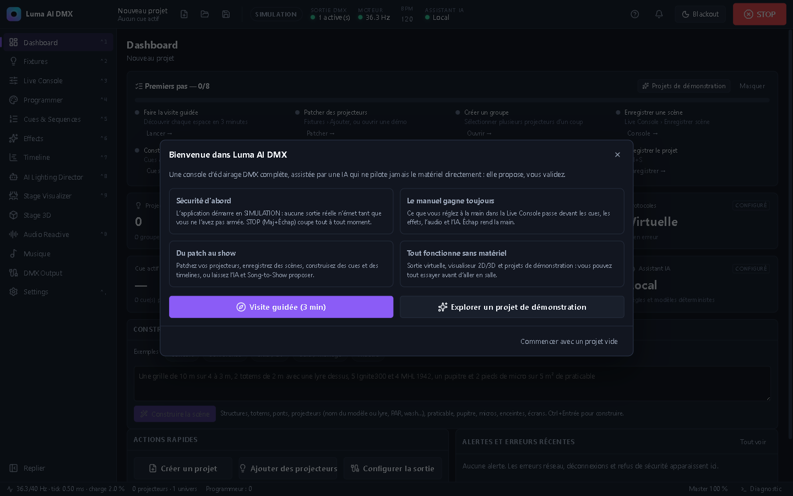<br>**Accueil** : visite guidée, projets de démonstration | 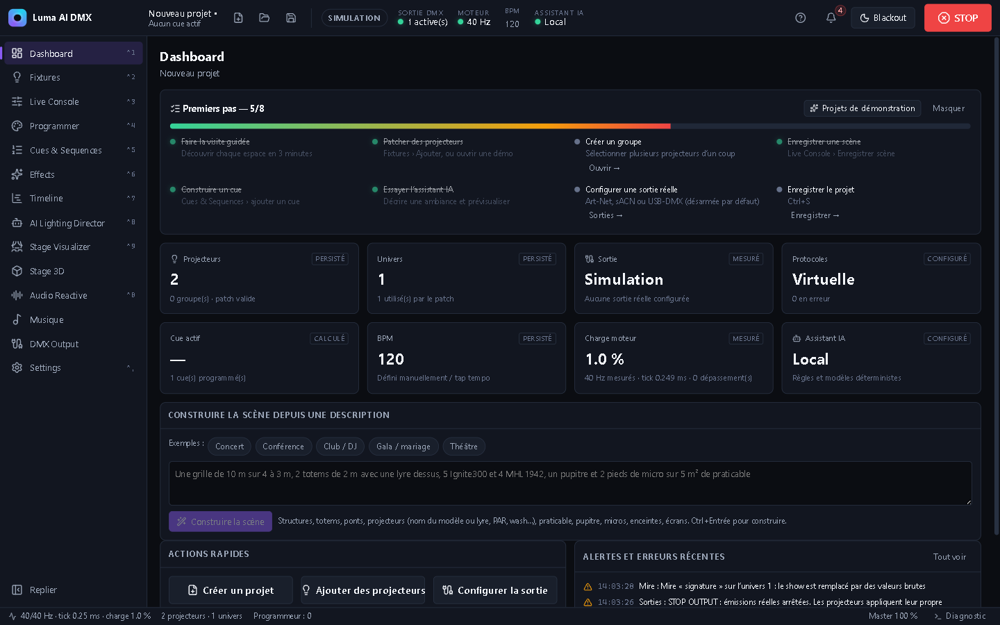<br>**Dashboard** : état des sorties, premiers pas |
| 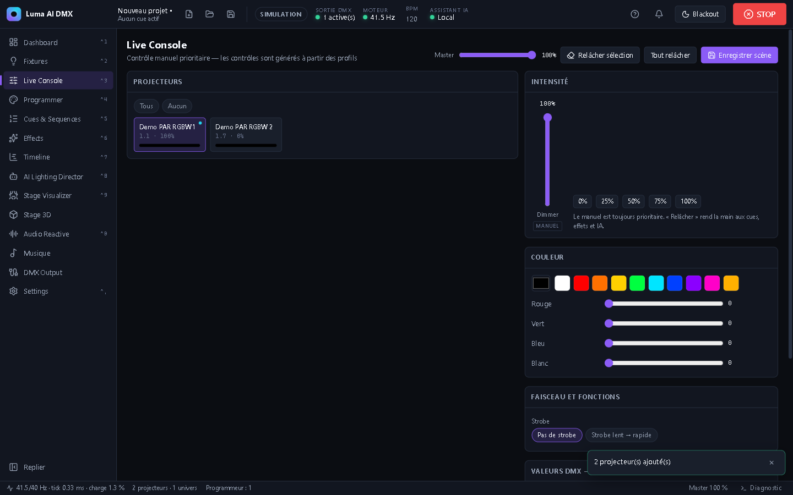<br>**Live Console** : contrôles générés depuis les profils | 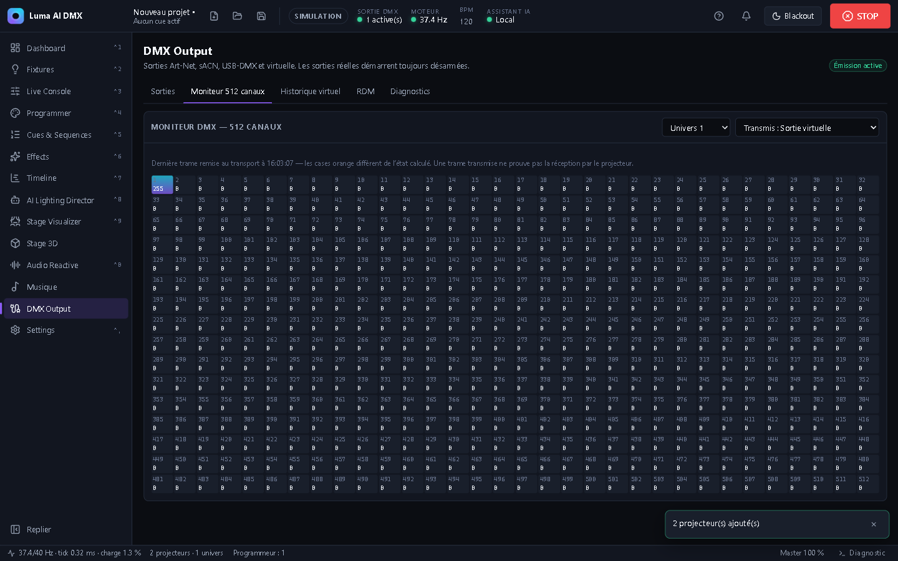<br>**DMX Output** : état calculé et trames transmises |
| 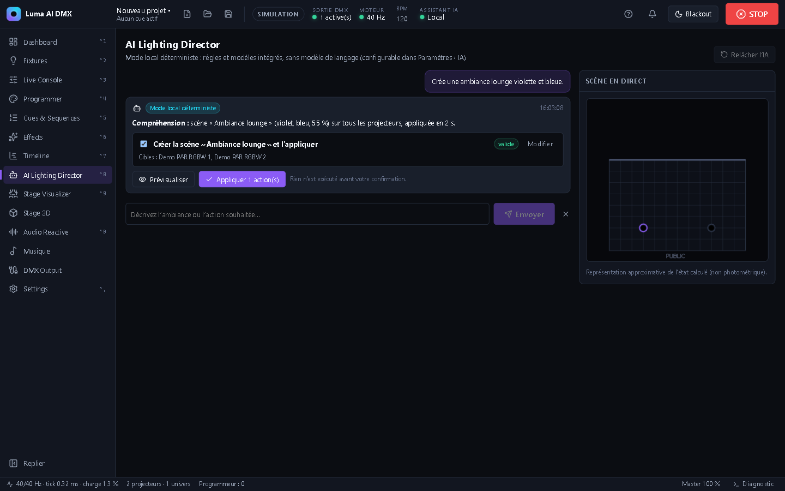<br>**AI Lighting Director** : proposition validée avant application | 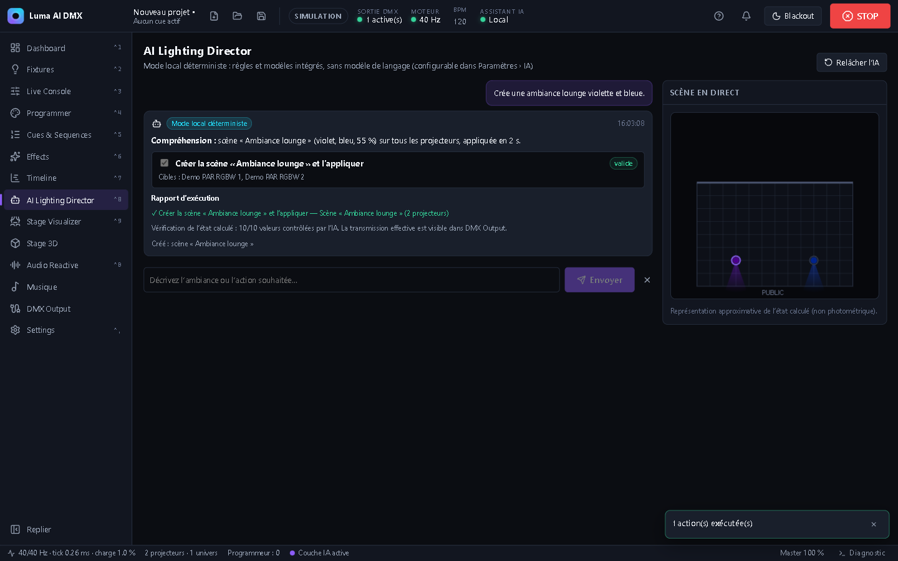<br>**Rapport d'exécution** de l'IA |
| 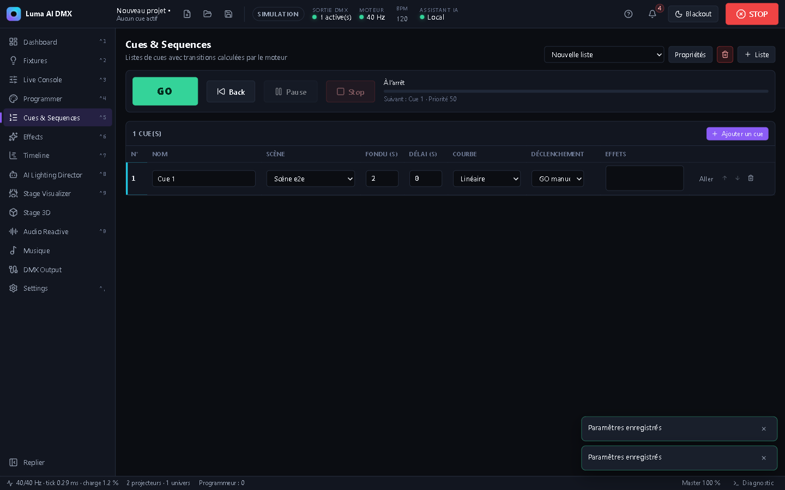<br>**Cues & Sequences** | 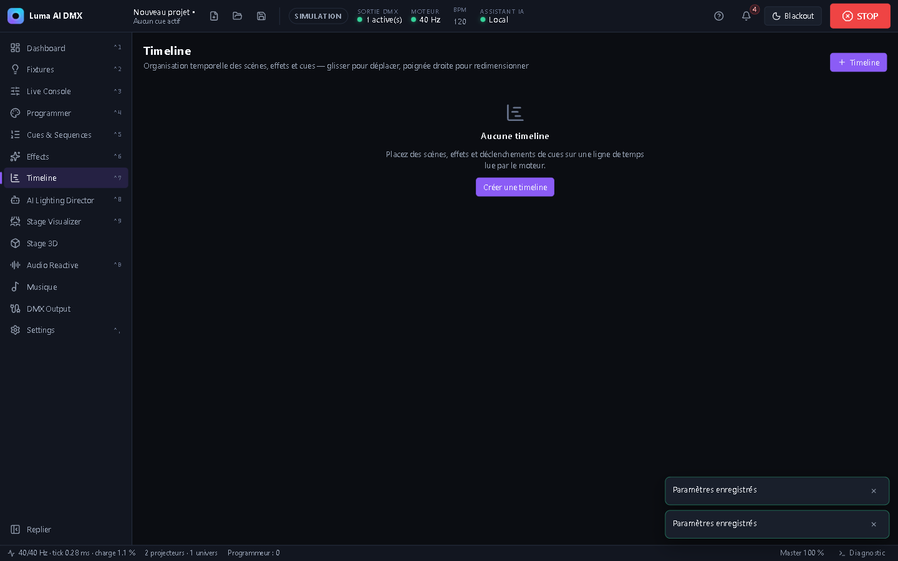<br>**Timeline** |
| 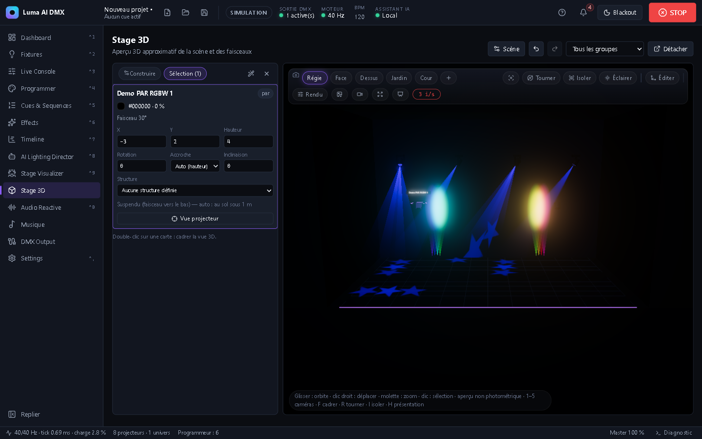<br>**Stage Visualizer 3D** : faisceaux, gobos, brume | 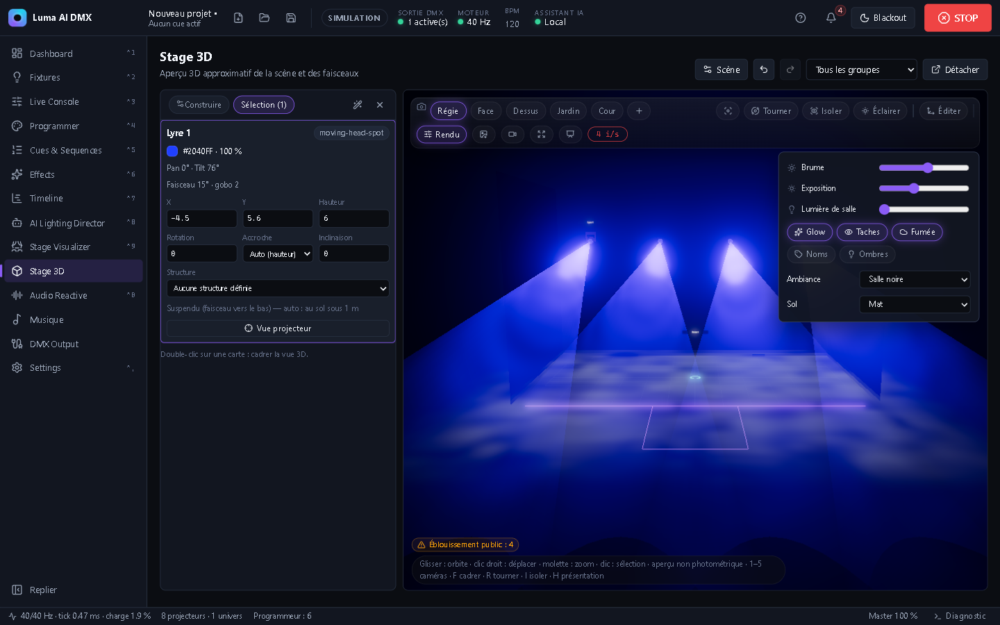<br>**Scène** : avancée, fumée, décor |
| 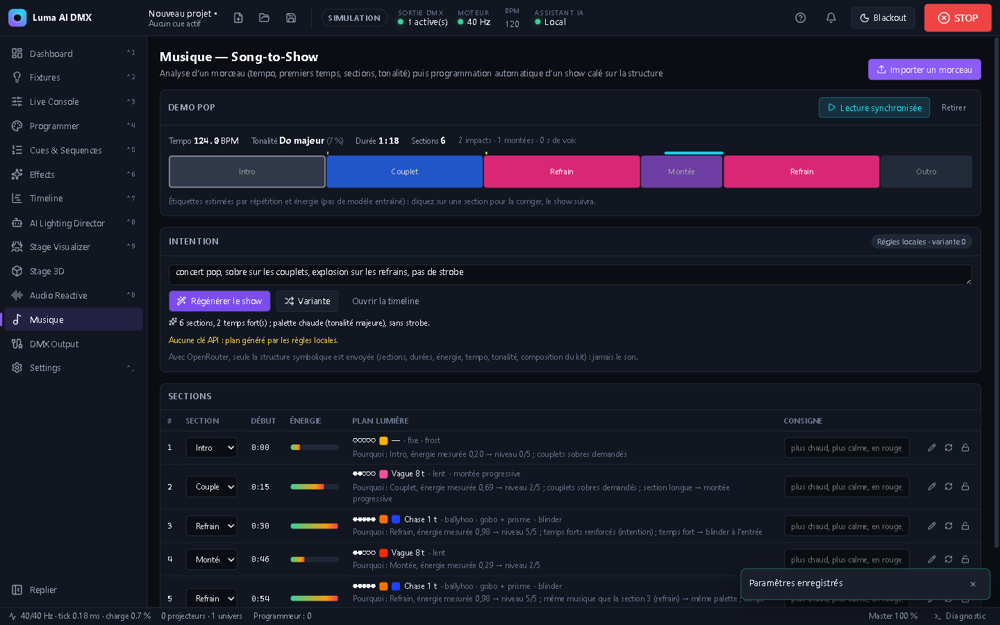<br>**Musique (Song-to-Show)** : analyse, plan par section | 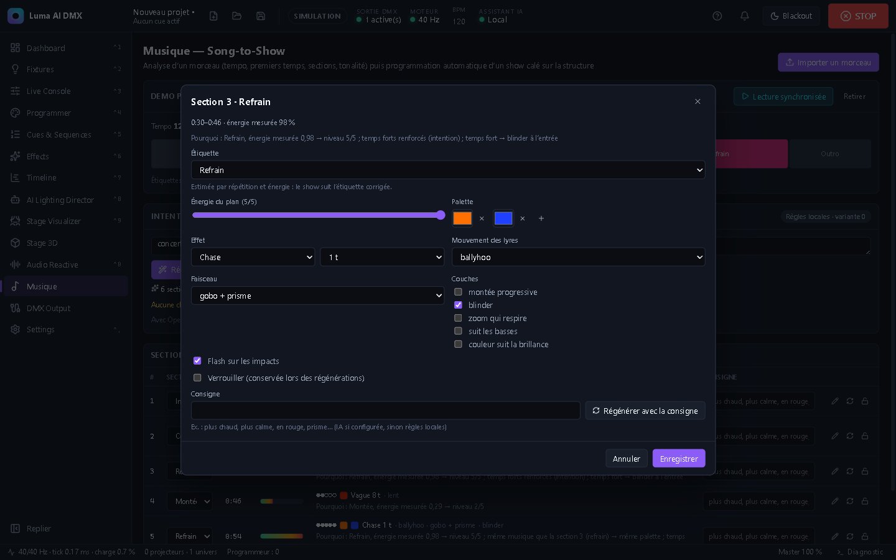<br>**Édition d'une section** : étiquette, look, consigne |
| 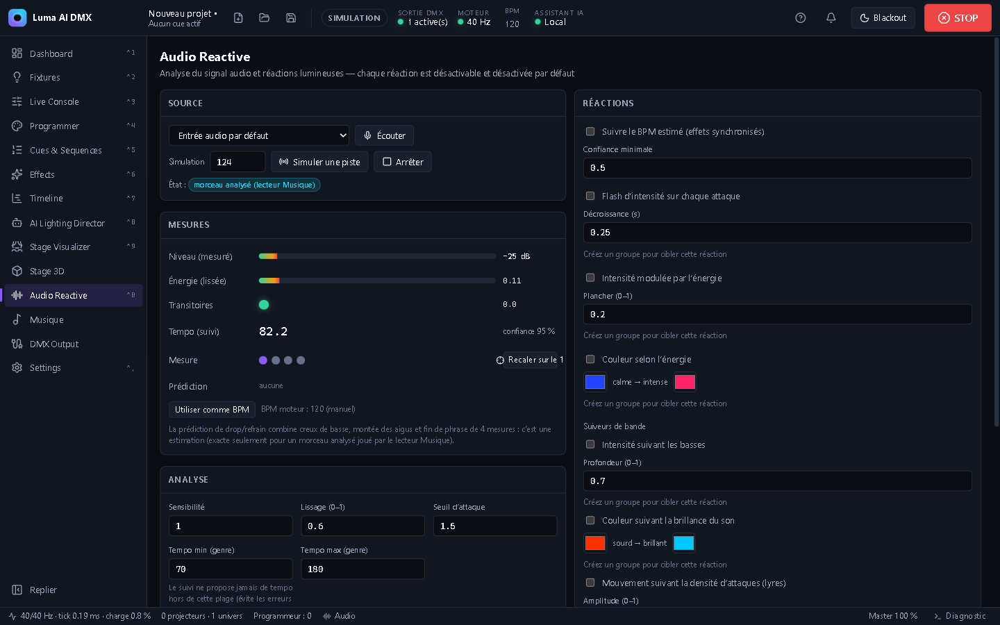<br>**Audio Reactive** : tempo suivi, prédiction de drop | 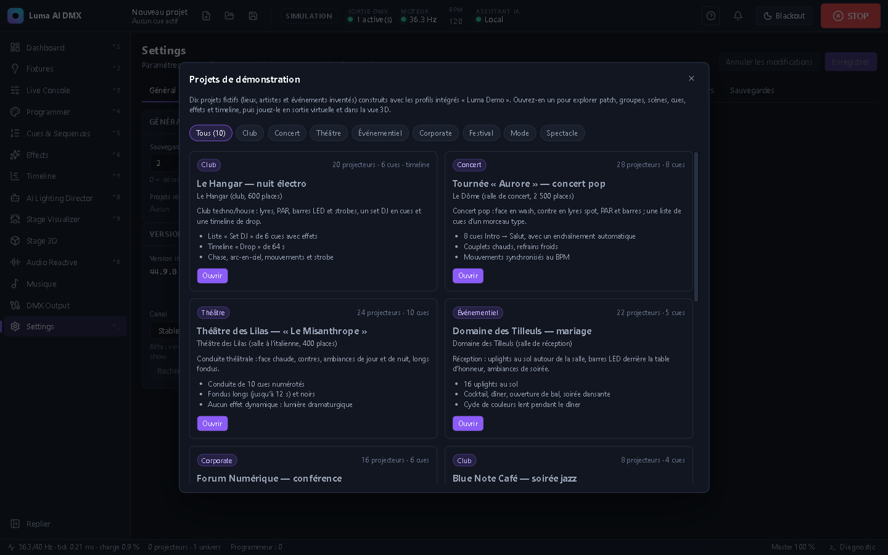<br>**Projets de démonstration** |

## Prérequis
- Node.js 22 ou plus récent (développé avec Node 24.16) et npm.
- Windows 10/11 x64 : c'est la plateforme où le build et les tests ont été exécutés. macOS et Linux sont configurés dans `electron-builder.yml`, mais **n'ont pas été construits ni testés**.
- Facultatif : une clé API OpenRouter pour utiliser un modèle de langage externe.
- Facultatif : une clé API Google Gemini (Google AI Studio) pour l'assistant vocal.

## Installation et démarrage
```bash
npm install
```
```bash
npm run dev
```
`npm run dev` démarre Electron avec rechargement à chaud. Pour lancer le build de production sans installateur :
```bash
npm run build
```
```bash
npm start
```

Variable d'environnement utile : `LUMA_USER_DATA` redirige le dossier de données de l'application (projets, clés chiffrées, licence) vers un autre dossier, par exemple pour tester sans toucher à vos projets. `LUMA_E2E` est réservée aux tests de bout en bout.

## Compilation, tests et packaging
| Commande | Rôle |
|---|---|
| `npm run typecheck` | TypeScript strict (`strict`, `noUncheckedIndexedAccess`) |
| `npm run lint` | ESLint (typescript-eslint + règles des hooks React), taille des fichiers (600 lignes max) et textes en dur hors i18n |
| `npm test` | Vitest : tests unitaires, d'intégration et de composants |
| `npm run test:watch` | Vitest en mode surveillance |
| `npm run test:coverage` | Tests avec seuils de couverture sur `src/core` |
| `npm run eval` | Banc d'évaluation de l'IA locale (`tests/eval/cases.json`) : scores, latence, 0 violation de sécurité exigée ; rapport `test-results/ai-eval.json` |
| `npm run test:perf` | Mesures temps réel (cadence et gigue de l'ordonnanceur, charge de 1 000 projecteurs), exécutées seules pour ne pas être faussées par les autres tests |
| `npm run test:e2e` | Build puis Playwright, qui pilote l'application Electron réelle |
| `npm run check` | typecheck + lint + tests + tests de performance |
| `npm run package` | Installateur Windows NSIS dans `release/` |
| `npm run package:dir` | Application décompressée, sans installateur |
| `npm run release` | Script de publication (`scripts/release.mjs`) ; voir [Contribuer](#contribuer) |

## Prise en main
0. **Premier lancement** : l'écran de démarrage propose de créer un projet, d'ouvrir un fichier, de rechercher parmi les projets récents, de continuer le projet en cours ou d'ouvrir une démo. L'accueil propose aussi une **visite guidée** en 18 étapes. Elle met en surbrillance chaque zone de l'interface et ouvre les pages qu'elle décrit (←/→ pour avancer, Échap pour quitter). L'accueil donne aussi accès aux **31 projets de démonstration fictifs**, du club de jazz au concert en stade : club électro, concert pop et rock, théâtre, comédie musicale, opéra, mariage, conférence, festival, défilé, gala, cirque, karaoké, e-sport, match de basket, cathédrale, orchestre symphonique… Chacun est livré avec patch, groupes, scènes, cues, effets, parfois une timeline, et un décor réaliste tiré de la bibliothèque d'équipements (line arrays, batteries, amplis, claviers, régies, murs LED). Tous sont jouables en sortie virtuelle et en 3D. Sur le Dashboard, la liste **« Premiers pas »** se coche d'elle-même au fil de votre progression. Le bouton **?** de la barre supérieure relance la visite, ouvre la galerie de démos ou réaffiche la liste. Les démos s'ouvrent comme des copies non enregistrées (Ctrl+S pour les conserver) ; lieux, artistes et événements sont inventés.
1. **Créer un projet** : icône « + » de la barre supérieure ou `Ctrl+N`.
2. **Patcher des projecteurs** : *Fixtures › Ajouter*. Choisissez un profil, un mode, un univers et une quantité. L'adresse est automatique ou manuelle. Les chevauchements et les dépassements de 512 sont refusés. Les profils inclus sont **fictifs** (« Luma Demo ») et servent aux tests : ils ne décrivent aucun modèle commercial. Pour vos projecteurs, utilisez *Fixtures › Open Fixture Library* (catalogue en ligne ou fichier OFL), ou *Fixtures › Importer* un fichier **GDTF** (`.gdtf`, tous ses modes), un export **grandMA2** (`.xml`), une collection `.zip` ou un profil au format Luma (voir [docs/PROFILE_FORMAT.md](docs/PROFILE_FORMAT.md)) ; la sélection multiple est acceptée et un fichier illisible n'interrompt pas les autres.
   - **MA Fixture Share** : le bouton du même nom ouvre le site dans une fenêtre isolée (session à part, sans accès à l'application). Connecté avec votre compte MA, chaque fiche téléchargée (grandMA2 `.xml`, collection `.zip`, GDTF) est convertie et ajoutée à la bibliothèque, les modes d'une même machine fusionnés. Les fiches grandMA3 sont refusées avec un message clair.
   - **Bibliothèque grandMA2** : si grandMA2 onPC est installé, *Fixtures › Bibliothèque grandMA2* parcourt sa bibliothèque locale (fabricant, modèle) et importe tous les modes d'un appareil en un seul profil.
   - **Localiser par caméra** (*Fixtures › Localiser par caméra*) : posez une webcam face au plateau, ou utilisez un smartphone qui envoie une photo par étape via la télécommande. L'application allume les projecteurs selon un codage binaire : 14 images pour 40 projecteurs, en 10 s environ. Le mode « un par un » est aussi disponible. Cliquez ensuite les 4 coins du plateau : les positions sont calculées à hauteur connue, ou triangulées en 3D avec 2 vues, puis appliquées au patch après validation. L'assistant signale les projecteurs muets, les adresses en double, les réponses incohérentes (adresse décalée, mode différent) et les projecteurs inversés (« ce que vous appelez Lyre 3 est en réalité à jardin »). Avec une sortie Art-Net, il compare aussi modèle, mode et adresse via RDM. **Sécurité** : confirmation obligatoire, intensité limitée à 60 %, lumière blanche, aucun strobe. Le programmeur est relâché et les autres sources sont masquées pendant la séquence. Les rotations ne sont pas mesurées. Précision validée sur scène synthétique (≤ 10 cm sur un plateau de 10 m), **pas encore sur un vrai plateau**.
3. **Piloter en manuel** : dans la *Live Console*, sélectionnez des projecteurs ou un groupe. Les contrôles sont générés à partir des fonctions du profil : dimmer, couleur (RGB, RGBW ou roue), pan/tilt 16 bits, shutter, gobo, couleur par cellule pour les barres LED… Le manuel est **toujours prioritaire**. `Échap` le relâche. La Live Console peut être détachée sur un second écran.
   - **Console Simplifiée** : une carte par machine avec tous ses paramètres en curseurs, groupes et ordre des cartes personnalisables. Elle peut s'ouvrir au démarrage et demander une confirmation pour la quitter (*Settings › Général*), pour un opérateur non spécialiste.
   - **Actions rapides** : boutons à bascule qui agissent sur la sélection active.
4. **Enregistrer une scène** : *Live Console › Enregistrer scène* (à partir des valeurs du programmeur).
5. **Créer des cues** : *Cues & Sequences*. Chaque cue référence une scène, avec un fondu, un délai, une courbe et un déclenchement manuel ou enchaîné. Commandes : `Espace` = GO, `Maj+Espace` = BACK, `P` = pause/reprise.
6. **Effets et timeline** : *Effects* (13 types, dont éventail pour les lyres, suiveur de basses et couleur par la brillance pilotés par l'audio en cours ; synchronisation BPM, graine aléatoire) et *Timeline* (scènes, effets et cues sur une ligne de temps, avec annuler/rétablir).
7. **Visualiseur** : page *Scène 2D/3D*, vue 2D de dessus, vue 3D (three.js), ou les deux côte à côte ou empilées.
   - Faisceaux volumétriques dans une brume réglable, avec halo (glow).
   - Taches de lumière et gobos au sol et sur le cyclorama.
   - Lyres articulées (base, lyre, tête suivant pan/tilt), facettes de prisme, flashs de strobe, zoom.
   - Un faisceau par cellule pour les barres LED.
   - Truss générés à partir du kit, avec pieds ; décor complet (plateau, cyclorama, coulisses, salle).
   - 5 caméras (Régie, Face, Dessus, Jardin, Cour), infobulle au survol, panneau du projecteur sélectionné (hauteur et rotation modifiables), noms, plein écran, compteur d'images/s.
   - Un projecteur à moins de 1 m de hauteur est considéré posé au sol : son faisceau part vers le haut.
   - 4 préréglages de qualité de rendu en un clic (Édition, Équilibré, Qualité, Présentation), public animé qui réagit à la musique, inspecteur des propriétés de la sélection.
   - **Construire** : bibliothèque d'équipements scéniques en 8 catégories (machines, structures, sonorisation, instruments, décor, interprètes, écrans, accessoires), avec recherche, favoris, miniatures, glisser-déposer et assemblages prêts à poser (portique, toiture, grille de rigging, façade son, batterie sur praticable). Modèles 3D procéduraux aux dimensions réelles ; import d'un modèle GLB possible. Un assemblage 3D n'est **ni un calcul de charge ni une validation de sécurité**.
   - **Assistant de scène** : « Ajoute deux line arrays de chaque côté, une batterie au centre arrière… » est traduit en ajouts positionnés, avec aperçu avant application et une seule étape annulable (Ctrl+Z).
8. **Musique (Song-to-Show)** : *Musique › Importer un morceau* (WAV, MP3, FLAC…). L'analyse se fait sur la machine (≈ 2 s pour 4 min) : tempo, premiers temps, sections étiquetées (intro, couplet, pré-refrain, montée, refrain, drop, break, pont, outro), tonalité, impacts, montées et passages chantés. Seule l'analyse est enregistrée dans le projet, avec l'empreinte SHA-256 du fichier : le son ne l'est jamais. Décrivez l'intention (« sobre sur les couplets, explosion sur les refrains, pas de strobe »), puis *Générer le show* : une timeline complète calée sur les sections, avec scènes, effets synchronisés au tempo et à la mesure, mouvements et accents sur les impacts.
   - **Groupes du projet** : « contres en couplet, faces au refrain » allume les groupes nommés dans les sections citées.
   - **Repères de scène** : avec un repère « Chanteur », les lyres font une douche sur lui dans les passages calmes et balaient le public sur les refrains. La visée pan/tilt est calculée avec la géométrie de la vue 3D.
   - **Vocabulaire d'effets** : éventail, ballyhoo, chase de couleurs, blinder à l'entrée des drops, zoom / iris qui respire, machines à fumée dosées selon l'énergie (« sans fumée » pour les couper).
   - **Montée progressive** : un couplet ou une montée longue part plus bas et gagne en intensité jusqu'à la section suivante.
   - **Suiveurs de bande** : en *Lecture synchronisée*, le dimmer peut suivre les basses et la couleur la brillance du morceau joué (« les lumières suivent les basses »).
   - **Poursuite sur la voix** : la voix est estimée (bande 300 Hz–3 kHz et stabilité harmonique) ; une lyre suit le chanteur uniquement quand il chante (« sans poursuite » pour la désactiver).
   - **Explication** : chaque section affiche pourquoi ce look (« refrain, énergie mesurée 0,92 ; même musique que la section 3 → même palette »).
   - **Édition** : un clic sur une section de la bande (ou le crayon du tableau) ouvre une fenêtre pour corriger l'étiquette, régler le look (énergie, palette, effet, mouvement, faisceau, couches, verrou) ou régénérer la section avec une consigne (« plus chaud », « en rouge »). *Variante* propose une autre version des sections non verrouillées.
   - **Avec OpenRouter** : le plan et la régénération d'une section passent par le modèle (la section, ses voisines et la consigne sont envoyées), avec repli sur les règles locales. Les réponses sont mises en cache sur la machine : la même demande (morceau, intention, kit, variante, modèle) ne refait aucun appel.
   - *Lecture synchronisée* joue le morceau : la timeline suit la position de lecture, et l'analyseur live écoute la sortie du lecteur (prédiction de drop exacte).
9. **Assistant IA** : *AI Lighting Director*. Décrivez l'ambiance souhaitée, vérifiez la proposition (cibles, avertissements, aperçu), modifiez ou excluez des actions, puis appliquez. Un rapport indique les actions exécutées, celles qui ont été ignorées et la vérification de l'état calculé.
10. **Enregistrer** : `Ctrl+S`. Au moment de quitter, l'application signale les modifications non enregistrées.

## Configuration DMX
Dans *DMX Output › Sorties* :
- **Art-Net** : destination IPv4 (nœud ou broadcast, par exemple `2.255.255.255`), interface locale, correspondance univers local → Port-Address (0–32767), séquence 1–255.
- **sACN / E1.31** : multicast (`239.255.hi.lo`) ou unicast, priorité 0–200, CID persistant. À l'arrêt, l'application envoie 3 paquets « stream terminated ».
- **USB-DMX (Enttec DMX USB Pro)** : choix du port série. La détection signale les puces FTDI, ce qui **ne confirme pas** qu'il s'agit d'une Enttec.
- **USB-DMX (Open DMX / FTDI sans microcontrôleur)** : le logiciel génère lui-même le break DMX puis la trame (250 000 bauds, 8N2). Cadence par défaut : 30 images/s.
- **Sortie virtuelle** : aucune émission matérielle.

Les sorties réelles **démarrent toujours désarmées**. Pour émettre, cliquez sur *Armer* puis confirmez. Le badge **SIMULATION / LIVE** de la barre supérieure indique en permanence si une sortie réelle est armée. Le bouton **STOP** (`Maj+Échap`) coupe immédiatement toutes les émissions réelles.

Le moniteur 512 canaux affiche séparément **l'état calculé** par le moteur et **la dernière trame transmise** par chaque sortie. Une trame transmise ne prouve pas que le projecteur l'a reçue.

## Mode virtuel
La sortie virtuelle (univers 1 à 4 par défaut) enregistre les trames reçues, l'historique des changements par canal (2 000 derniers) et des statistiques. Elle accepte aussi l'injection de défauts (*DMX Output › Diagnostics*) : erreurs d'envoi ou déconnexion simulée, pour vérifier les alertes et la reconnexion automatique (délai de 1 s à 10 s). Toute la programmation fonctionne sans matériel.

## Configuration de l'IA
- **Mode local déterministe (par défaut)** : règles et modèles intégrés, en français et en partie en anglais, sans réseau. Il comprend notamment les ambiances (lounge, club…), les couleurs, les durées, les intensités, les cibles (« les quatre lyres », noms de groupes), les effets (chase, vague, arc-en-ciel, pulse, mouvements, strobe si autorisé), les drops, les shows de N minutes, les variantes et les ajustements (« plus chaud et moins agressif »). Ce mode est signalé comme tel et ne se présente jamais comme un modèle de langage. Une demande non reconnue est déclarée comme telle.
- **OpenRouter** : *Settings › IA et fournisseurs* : fournisseur « OpenRouter », puis choix du modèle. *Charger la liste des modèles* affiche le catalogue OpenRouter avec recherche, contexte, prix par million de jetons et format pris en charge. On peut aussi saisir un identifiant `fournisseur/modèle` ; `openrouter/auto` laisse OpenRouter choisir. La clé API (`sk-or-v1-…`) est chiffrée par le système (Electron `safeStorage`) dans le processus principal. Elle n'est jamais renvoyée à l'interface ni écrite dans un projet. Le format JSON est imposé selon les capacités du modèle : sortie structurée (`json_schema`), sinon mode JSON, sinon consigne seule. La réponse est ensuite **revalidée** par le schéma strict de l'application. L'effort de raisonnement n'est transmis qu'aux modèles qui le prennent en charge. Si le fournisseur est indisponible (réseau, clé, crédits, modèle), l'application bascule sur le mode local et le signale. Données envoyées : la demande et une description du kit (noms, types, capacités, groupes, scènes).
- L'IA ne produit **que** des actions typées (contrat versionné, v3 : `setIntensity`, `setColor`, `setPosition`, `setBeam`, `startEffect`, `stopEffect`, `adjustEffect`, `createScene`, `applyScene`, `createCue`, `createSequence`, `setBpm`, `releaseAi`). En mode local, seuls les projecteurs nommés dans la demande sont modifiés. Elle n'envoie jamais de DMX, n'exécute aucun code et n'a pas accès aux fonctions spéciales (reset, lampe). Le strobe exige l'autorisation explicite *Autoriser l'IA à proposer des effets strobe*.

## Assistant vocal (Gemini Live)
Un bouton vocal de l'interface ouvre une session **Gemini Live** (modèle `gemini-3.8-live`, défini dans [`src/core/app/shared.ts`](src/core/app/shared.ts)) : vous parlez, l'assistant répond à voix haute et agit sur l'éclairage.

- **Activation** : *Settings › IA et fournisseurs*, champ **Clé Gemini (assistant vocal)**. Sans clé, le bouton reste désactivé. La clé est chiffrée par le système comme la clé OpenRouter.
- **Fonctionnement** : le processus principal ne transmet jamais la clé au rendu. Il émet un **jeton à usage unique** (`ai.voiceToken`), et c'est la fenêtre qui ouvre la session. Le micro est capté à 16 kHz, la voix de retour est lue à 24 kHz. La session s'arrête avec le composant : quitter la vue coupe le micro.
- **Outils** (définis dans [`src/renderer/voice/tools.ts`](src/renderer/voice/tools.ts)) : `propose_lighting` et `apply_proposal` (proposition puis application, comme l'assistant écrit), `undo_last`, `get_status`, et `control_engine` pour les cues (`cue_go`, `cue_back`, `cue_pause`, `cue_resume`).
- **Limites du rôle** : `control_engine` permet de couper ou rétablir le blackout, de régler le BPM, de piloter les cues (GO, Back, pause, reprise) et de libérer le programmeur ou l'IA. Il ne peut **pas** armer une sortie réelle ni la reprendre après un STOP : ces actions restent à l'opérateur.
- **Données envoyées** : pendant la session, le flux audio du micro et les messages sont envoyés à Google. Ce n'est pas le cas du mode local de l'IA. Le palier requis est celui des commandes `ai.*` (Standard).

## Licences et abonnements
Trois paliers contrôlent l'accès aux fonctions. La vérification est **hors ligne** : aucune connexion n'est nécessaire sur scène.

| Palier | Fonctions |
|---|---|
| **Starter** (sans licence) | Console, patch, scènes, cues, effets, visualiseur, audio réactif, sorties DMX |
| **Standard** | Starter + assistant IA (`ai.*`), Musique / Song-to-Show (`music.*`), Timeline (`timeline.*`) |
| **Pro** | Standard + RDM (`rdm.*`) et localisation par caméra (`locate.*`) |

- **Activation** : *Réglages › Général › Licence*, collez la clé puis *Activer*. Le badge du palier s'affiche dans la barre supérieure (violet = active, orange = période de grâce, rouge = expirée ou invalide) ; un clic ouvre les réglages. La clé est enregistrée dans `license.key`, dans le dossier de données de l'application.
- **Abonnements** : une licence peut avoir une échéance. Après celle-ci, le palier reste actif **7 jours** (période de grâce), puis l'application revient en Starter. Sans échéance, la licence est perpétuelle.
- **Format** : clé `payload.signature`, signée Ed25519 ; seule la clé publique ([`src/core/license/publicKey.ts`](src/core/license/publicKey.ts)) est dans l'application. Toute commande réservée à un palier supérieur est refusée par le processus principal, y compris via la télécommande.
- **Émettre des licences** (vendeur) :
```bash
node scripts/license.mjs keygen
```
```bash
node scripts/license.mjs issue --tier pro --sub client@exemple.fr --days 365
```
  `keygen` crée la clé privée dans `~/.luma-license-private.pem` (ou `LUMA_LICENSE_KEY`), **hors du dépôt : sauvegardez-la**, sa perte empêche d'émettre de nouvelles licences. Collez ensuite la clé publique affichée dans `publicKey.ts`. Sans `--days`, la licence est perpétuelle.
- **Limites** : vérification côté client, sans serveur : l'horloge de la machine n'est pas contrôlée, le nombre d'appareils n'est pas limité et une licence ne peut pas être révoquée. Aucune restriction n'est appliquée en développement et dans les tests (pas de clé publique fournie au service).

## Sécurité
- Electron : `contextIsolation`, `sandbox`, `nodeIntegration: false`, CSP stricte, navigation bloquée, nouvelles fenêtres limitées à la vue 3D et à la Live Console détachées, seules les permissions micro (audio réactif, LTC), MIDI et plein écran sont accordées. Une seule instance de l'application tourne à la fois. La fenêtre MA Fixture Share a sa propre session, sans preload ni permission, et ne reçoit aucun événement de l'application. Le renderer ne reçoit qu'une API à deux fonctions (`invoke` et `on`). Chaque commande IPC est validée par Zod dans le processus principal ; les origines inconnues sont refusées.
- Priorités : le manuel est toujours prioritaire. À priorité égale : HTP pour l'intensité, LTP pour le reste. Une priorité supérieure remplace. Détails dans [docs/ARCHITECTURE.md](docs/ARCHITECTURE.md).
- Fonctions spéciales : les plages marquées `dangerous` dans les profils (reset, extinction de lampe) ne sont émises qu'après confirmation manuelle. Toute autre source est ramenée à la valeur par défaut du canal.
- Blackout configurable (*Settings › Moteur & sécurité*) : intensités seules, intensités + shutter fermé (par défaut), ou tous les canaux à 0. **Le blackout n'est pas un état universellement sûr** : vérifiez le comportement de vos appareils.
- Strobe : fréquence plafonnée (10 Hz par défaut, réglable).
- Protection contre les boucles : un seul enchaînement automatique de cue par tick, applications IA limitées à une toutes les 300 ms, au plus 50 actions par proposition et 64 cues par séquence.
- Garde-fou photosensible (*Settings › Moteur & sécurité*) : estimation des flashs vus par le public (> 3 flashs/s ou strobe rapide sur une part importante du kit, logique des tests Harding / ITU-R BT.1702). *Avertir* (par défaut) affiche une alerte ; *Limiter* borne la vitesse de variation des intensités et couleurs et ouvre les strobes rapides, sauf sur ce que tient le programmeur. Les effets IA qui dépasseraient la limite sont refusés à la validation (simulation de 3 s). **Estimation à partir d'un modèle approximatif, pas une certification.**
- Contrôle externe (*Settings › Contrôle externe*, tout désactivé par défaut) : MIDI (apprentissage de touches et faders), OSC sur UDP (127.0.0.1 par défaut), timecode MTC ou LTC (la timeline suit), télécommande tablette sur le réseau local protégée par jeton. Aucune de ces entrées ne peut armer une sortie ni reprendre les émissions.
- RDM via Art-Net (*DMX Output › RDM*) : découverte, lecture (modèle, adresse, heures, capteurs), identify et changement d'adresse sur confirmation. Testé contre un nœud simulé uniquement ; RDM via Enttec non implémenté.
- STOP OUTPUT : arrêt des émissions. Ensuite, **chaque projecteur applique son propre comportement en cas de perte de signal DMX** (maintien de la dernière valeur ou extinction selon le modèle). Consultez la documentation de vos appareils.

## Limites matérielles
- **Aucun matériel DMX n'a été testé.** Art-Net et sACN sont implémentés d'après les spécifications. Le format des paquets et l'émission UDP sont vérifiés par des tests en boucle locale (`127.0.0.1`), mais pas avec un nœud ou un projecteur réel.
- Les pilotes USB-DMX (Enttec DMX USB Pro « label 6 » et Open DMX FTDI) n'ont pas été vérifiés sur matériel. En Open DMX, le break est généré par des appels système : il dure environ 1 ms ou plus, avec une gigue qui dépend du système et du pilote FTDI. Certains récepteurs sensibles au timing peuvent mal le tolérer.
- La fréquence d'émission est **mesurée**, pas garantie. L'ordonnanceur calibre la résolution des timers de la machine et termine l'attente par de courtes boucles `setImmediate` : en test, 40 et 44 Hz sont tenus à ± 0,5 Hz ; la gigue p95 visée est < 2 ms, mais elle a été mesurée entre 3 et 4 ms sur une machine de développement chargée (valeur affichée dans la barre d'état, voir LUMA-007 dans la [roadmap](ROADMAP.md)). Ces boucles coûtent un peu de CPU (jusqu'à environ 16 ms d'attente active par période si les timers du système sont grossiers). Les latences réseau et d'interface ne sont pas mesurées.
- Les visualiseurs 2D et 3D sont des représentations approximatives, pas des simulations photométriques : pas d'atténuation réelle ; les gobos sont des textures génériques et les ombres sont limitées aux projecteurs les plus intenses.
- Audio en direct : le tempo est suivi par autocorrélation dans la plage de tempo du genre (*Audio Reactive › Analyse*), avec un filtre de Kalman. En test, il se verrouille en moins de 4 s, sans erreur d'octave de 80 à 170 BPM. Le premier temps se déduit des accents de basse, et *Recaler sur le 1* le corrige d'un tap. La **prédiction de drop/refrain** combine creux de basse, montée des aigus et fins de phrase de 4 mesures avec des poids réglés à la main : c'est une estimation, pas un modèle entraîné. Le GO sur drop prédit ne part que s'il est **armé** explicitement, une seule fois, et il n'est jamais armé au démarrage.
- Analyse de morceau : les étiquettes de sections viennent de règles (répétitions, énergie, basses), validées sur des morceaux synthétiques seulement. Corrigez-les si besoin. La détection de la voix repose aussi sur des règles : un instrument soliste dans le même registre (synthé lead) peut être pris pour une voix.

## Problèmes connus
- Projecteurs multi-cellules : les effets Rainbow et Color cycle se répartissent par cellule ; les autres effets (chase, pulse…) agissent sur le projecteur entier.
- Import OFL : conversion automatique à vérifier avec le manuel. Les canaux non représentables (24 bits, fonctions sans équivalent) deviennent des canaux génériques, adresses conservées. Les ordres de pixels autres que XYZ sont approximés. Le catalogue en ligne passe par l'API GitHub (limite d'environ 60 requêtes/heure sans authentification).
- Dans une liste de cues, les attributs non-intensité absents du cue suivant sont **maintenus** (tracking), alors que les intensités absentes retombent à 0.
- Quand une proposition IA contient plusieurs actions immédiates avec des fondus différents, le fondu le plus long s'applique à l'ensemble.
- Raccourcis : configurables dans *Settings › Raccourcis* ; annuler/rétablir de la timeline restent fixés à Ctrl+Z / Ctrl+Y.
- OpenRouter n'a été testé qu'avec des réponses simulées : aucun appel facturé n'a été effectué. La liste réelle des modèles a, elle, été récupérée avec succès.
- L'installateur n'est pas signé (avertissement SmartScreen possible).
- L'assistant vocal n'a pas été testé avec une clé réelle sur le matériel : les tests utilisent des réponses simulées.
- `npm run test:perf` (gigue p95 < 2 ms) peut échouer sur une machine chargée, indépendamment du code (LUMA-007).
- Une commande refusée s'affiche dans une fenêtre bloquante dont le titre reste en français dans l'interface anglaise (LUMA-085).
- `CHANGELOG.md` n'a pas de section par version depuis la 0.2.0 : les nouveautés des versions 1.x sont dans « Non publié » (LUMA-087).

## Structure du projet
```
src/
  core/      logique métier sans Electron ni React : moteur, IA, musique, sorties, licences
  main/      processus principal Electron : fenêtres, IPC, cycle de vie, mises à jour
  preload/   pont exposé au rendu (deux fonctions : invoke et on)
  renderer/  interface React : composants, fonctionnalités, i18n, voix, vision
  shared/    commandes, types et marque partagés avec le rendu
tests/       unitaires, composants, performance, évaluation de l'IA, bout en bout
docs/        architecture, formats de projet et de profil, ADR, feuilles de route, captures
scripts/     licence, publication, contrôles (taille des fichiers, i18n, messages de commit)
```
La description détaillée des couches et des priorités est dans [docs/ARCHITECTURE.md](docs/ARCHITECTURE.md).

## Contribuer
Le guide complet est dans [CONTRIBUTING.md](CONTRIBUTING.md). En bref :
- une branche par changement, partie de `master` ;
- des commits au format [Conventional Commits](https://www.conventionalcommits.org/fr/) (`feat(scene): …`, `fix(engine): …`), vérifiés par `scripts/check-commits.mjs` ;
- `npm run check` doit passer avant chaque commit ; la CI (`.github/workflows/ci.yml`) relance typecheck, lint, tests avec couverture et e2e ;
- toute modification visible ajoute une ligne dans la section « Non publié » de [CHANGELOG.md](CHANGELOG.md) ;
- tout nouveau texte d'interface passe par `src/renderer/i18n` (clés en français et en anglais).

## Licence du dépôt
Le dépôt ne contient pas encore de fichier `LICENSE` : les conditions de réutilisation du code ne sont pas définies. Les licences décrites plus haut concernent l'usage de l'application, pas le code source.
